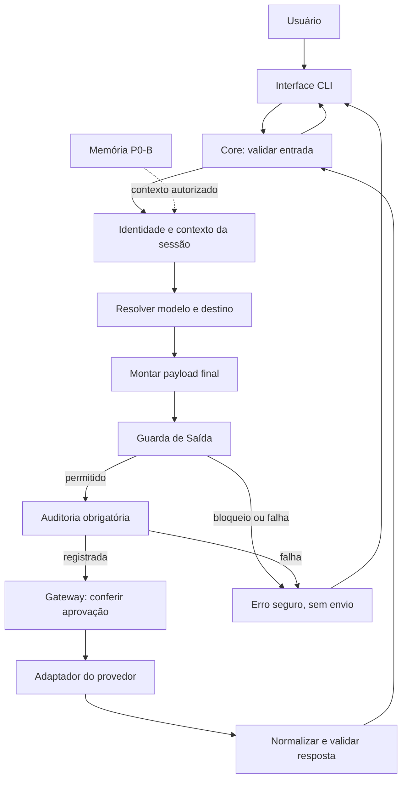

# Arquitetura

**Diretriz consolidada:** monólito modular local em Python. Não são necessários microsserviços, framework de agentes ou locks distribuídos para o núcleo inicial.

## Componentes

| Componente | Responsabilidade | Limite |
|---|---|---|
| Interface | Receber texto, mostrar resposta e estado. | Não contém regras do Gateway ou memória. |
| Core | Coordenar sessão, contexto, identidade e geração. | Não conhece detalhes HTTP de provedores. |
| Identity | Constituição, perfil e preferências aplicáveis. | Não concede permissões nem chama ferramentas. |
| Context builder | Montar histórico, instruções e contexto dentro do orçamento. | Preserva origem e sensibilidade. |
| Output Guard | Avaliar o envio ao destino selecionado. | Não gera conteúdo nem substitui o autorizador. |
| Gateway | Normalizar geração, falhas e limites. | Não contorna Guarda/auditoria. |
| Router | Selecionar modelo conforme modo/regras. | Não depende inicialmente de outro LLM. |
| Providers | Comunicação específica com API ou FakeModel. | Não recebidos diretamente pela UI. |
| Authorizer | Decidir autorização determinística. | Nega execução de ferramentas no P0-A. |
| Audit | Registrar metadados operacionais. | Evita prompts e credenciais por padrão. |
| Memory | Persistência e recuperação confiáveis. | Somente a partir de P0-B. |

## Fluxo de uma interação



A ordem é conceitual. A validação do modo, do modelo e do endpoint pode ocorrer antes da montagem. O requisito invariável é avaliar **o payload final e o destino real** antes de qualquer transmissão.

## Sequência P0-A

1. Carregar e validar configuração/Constituição.
2. Receber e validar entrada.
3. Resolver instruções de identidade, pedido atual e histórico dentro do orçamento.
4. Resolver modelo/destino por seleção manual ou regras.
5. Montar payload preservando classificação dos dados.
6. Avaliar a Guarda; bloquear em caso de proibição ou incerteza operacional.
7. Registrar a decisão permitida na auditoria obrigatória.
8. Verificar no caminho de envio que a aprovação corresponde ao conteúdo/destino.
9. Chamar adaptador com timeout e limites.
10. Normalizar resposta ou erro; registrar resultado.
11. Atualizar estado de sessão de maneira consistente e apresentar ao usuário.

Um erro não deve inserir uma resposta fictícia no histórico. A estratégia exata de commit dos turnos e de descarte de entradas bloqueadas será especificada na implementação.

## Fallback

Uma falha recuperável pode selecionar outro modelo somente se a configuração permitir. Destino e payload são avaliados novamente. Bloqueio da Guarda, falha de auditoria ou erro de autorização interrompem o fluxo; não acionam fallback.

Mesmo quando o destino não muda, uma transformação do payload invalida a aprovação anterior. A forma técnica de vinculação é proposta em [contratos](10-contratos.md).

## Dependências

- UI depende de interfaces de aplicação.
- Core depende de contratos públicos de Identity, Gateway, Guard, Audit e Memory quando existir.
- Adaptadores dependem de contratos do Gateway e clientes específicos.
- Memory não incorpora chamadas livres a provedores; extração por modelo, se usada, atravessa Gateway e Guarda.
- Identity não importa internals de storage.
- Logs/auditoria não recebem objetos secretos completos.
- Provedores são construídos na composição da aplicação; código de domínio não os instancia diretamente.

## Estrutura proposta

```text
Neo-mist/
├── README.md
├── docs/
├── pyproject.toml                 # futuro
├── .env.example                  # futuro
├── config/                       # futuro
│   ├── settings.yaml
│   ├── constitution.yaml
│   └── models.yaml
├── src/mist/                     # futuro
│   ├── main.py
│   ├── core/
│   ├── identity/
│   ├── safety/
│   ├── gateway/
│   │   └── providers/
│   ├── authorization/
│   ├── observability/
│   └── memory/                   # P0-B
└── tests/                        # futuro
    ├── unit/
    ├── integration/
    └── security/
```

Não criar arquivos vazios para simular implementação. Módulos entram quando necessários. Nome do pacote, versões e biblioteca HTTP permanecem pendentes.

## Extensão futura

Percepção, ferramentas, planejamento e autonomia ampliada usam interfaces explícitas. A interface desktop troca a apresentação; não exige refazer o domínio. Modelos locais usam um adaptador. Um estado emocional futuro influencia expressão e nunca sobrepõe precisão, segurança ou permissões.

Modularidade deve ser demonstrada por substituição e limites de importação, não pela quantidade de pastas.

