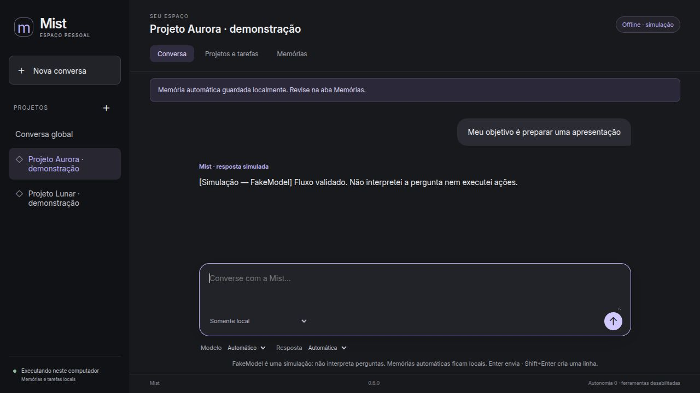
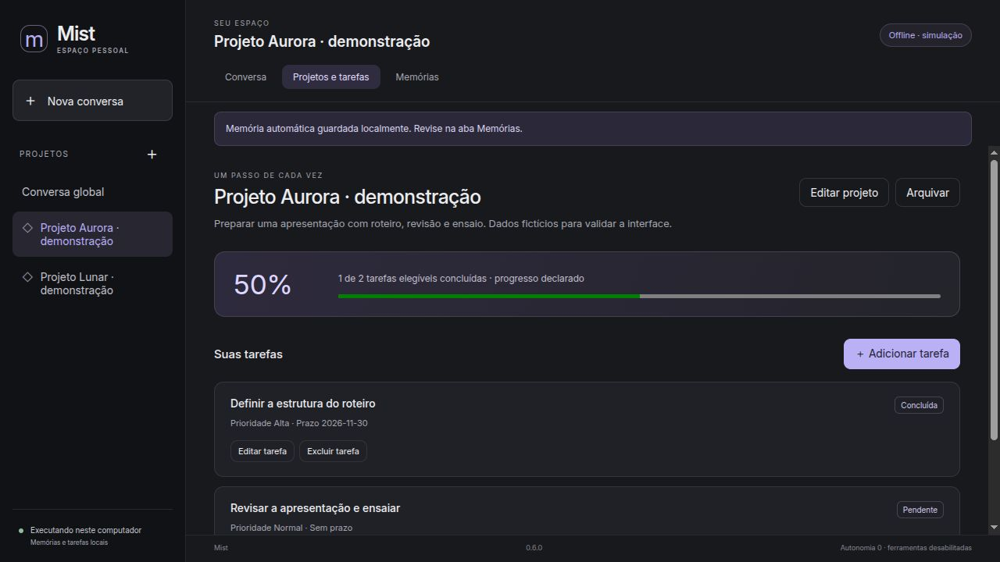
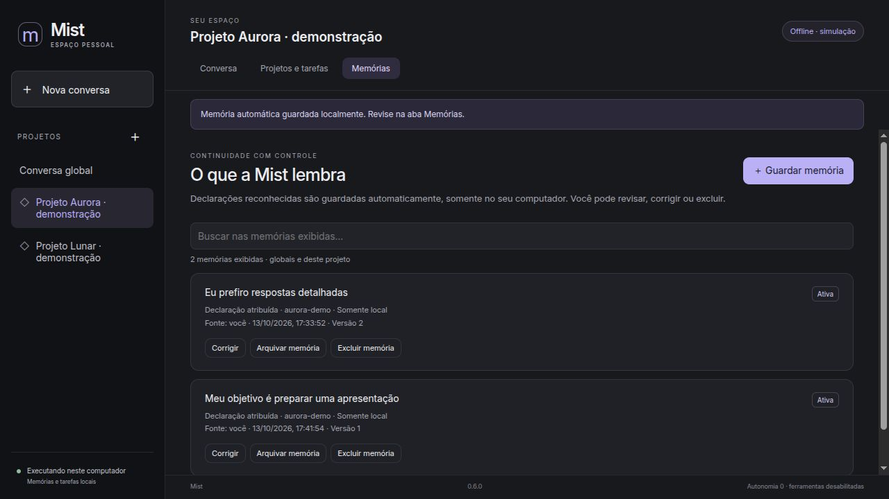

# Interface visual local — Mist 0.6.0

## Decisões e entrega

Em 13/10/2026 o usuário escolheu uma interface visual local como próximo
incremento e pediu um app com visual inspirado no ChatGPT. A entrega usa barra
lateral de projetos, conversa central, compositor e áreas de tarefas e memórias.
Não copia marca, ativos ou interface proprietária de terceiros.

É um app web servido por um processo Python **somente neste computador**. Não
há hospedagem, conta online ou instalação de Electron. HTML, CSS e JavaScript
estão no pacote; não carregam fontes, bibliotecas, analytics ou assets externos.

## Abrir

Com o pacote instalado no ambiente virtual:

```sh
.venv/bin/mist-ui --open-browser
```

Ou a partir da fonte, com Pydantic instalado:

```sh
PYTHONPATH=src python -m mist.ui --memory-dir runtime/ui
```

Abra o endereço `http://127.0.0.1:PORTA` impresso no terminal. A porta é escolhida
automaticamente; `--port 8765` fixa uma porta livre. Mantenha o terminal aberto;
Ctrl+C encerra o app e fecha o armazenamento. A porta não é exposta à rede local.

Sem `--memory-dir`, usa `$XDG_STATE_HOME/neo-mist/ui` ou
`~/.local/state/neo-mist/ui`. Esse diretório guarda memórias, registro de exclusões
e catálogo de projetos com as proteções descritas nos documentos 25 e 27. CLI e
interface podem usar o mesmo diretório **em momentos diferentes**: o bloqueio
impede dois processos simultâneos. `--audit-path` seleciona a auditoria; o padrão
é o mesmo do CLI. Nunca colocar o diretório privado no Git.

## Conversa

- **Conversa global** seleciona memórias globais. Um projeto seleciona suas
  memórias e as globais; trocar de projeto limpa o contexto transitório.
- **Nova conversa** limpa contexto e preferências da sessão, sem apagar dados
  persistentes. Não há histórico de chats salvo entre reinícios nesta versão.
- Enter envia e Shift+Enter cria uma linha. A mensagem fica no campo se o envio
  falhar. O app não repete uma geração automaticamente.
- Modelo Automático/Rápido/Principal corresponde a AUTO/FAST/PRIMARY. Resposta
  automática/concisa/detalhada usa o mecanismo existente do Core.
- O padrão é **offline, FakeModel**: a resposta é uma simulação do fluxo e não
  interpreta a pergunta. A tela e as respostas identificam essa condição.

Para configurar geração NVIDIA de forma explícita:

```sh
.venv/bin/mist-ui --config-dir examples/nvidia --allow-external --ask-api-key
```

A chave é digitada com entrada oculta **no terminal**, ou lida de
`NVIDIA_API_KEY`. Não é entregue ao navegador, gravada em assets ou colocada na
URL. Não há formulário de chave na página.

O compositor começa em **Somente local**. Com modelos NVIDIA, isso bloqueia a
geração externa; não oferece um modelo local inteligente como alternativa.
Escolher **Permitir envio à API configurada** permite à Guarda avaliar mensagem
e contexto para o destino configurado. Memórias locais ficam excluídas da
recuperação externa; contexto transitório derivado de dados locais pode bloquear
um envio posterior. Nova conversa limpa esse contexto. O catálogo de projetos
não é inserido automaticamente na conversa ou no payload do modelo.

A captura automática pode guardar uma declaração local antes de uma geração
falhar. A interface mostra o aviso e atualiza o estado; não transforma a falha
em resposta. Controle NVIDIA de cadência/HTTP429 permanece o do documento 24.
As pendências de condições de dados da conta permanecem no documento 22.

## Projetos, tarefas e memórias

Criar um projeto solicita nome e objetivo, gera um identificador interno e o
seleciona. É possível editar nome/objetivo, arquivar e reabrir na barra lateral.
Tarefas podem ser criadas, editadas com estado, prioridade e prazo, ou excluídas
com confirmação. Progresso é **declarado pelo usuário**, excluindo tarefas
canceladas do denominador; não certifica execução.

A área de memórias mostra conteúdo, escopo, origem, estado e versão. Permite
guardar manualmente, filtrar os itens exibidos, corrigir, confirmar candidatos,
arquivar, restringir ao local e excluir com confirmação. A exclusão também limpa
contexto, versões e derivados conforme o documento 25; não remove cópias antigas
fora do armazenamento. Correções ficam locais. A interface mostra até 200
memórias por escopo e avisa se há mais; a busca da página filtra somente esses
itens. Busca lexical completa, autorização externa por item, snapshots,
recuperação e exportação continuam disponíveis no CLI. Não há importação,
backup ou acesso a arquivos arbitrários pela página.

## Fronteira local e limites

O servidor usa `HTTPServer` serial. Aplicação, sessão e conexão SQLite são criadas
e utilizadas na mesma thread. Enquanto gera, não atende outra operação; a tela
mostra espera e desabilita controles. Não há cancelamento de geração pelo app
nesta versão. Fechar a aba não garante cancelar uma requisição já aceita.

Host exato, origem de alterações, token aleatório por processo e Fetch Metadata
protegem a API contra uso por outras páginas e DNS rebinding. Token é da sessão
local, não é a chave NVIDIA. Não há CORS permissivo. CSP bloqueia recursos
externos e frames; respostas privadas usam `no-store`. Rotas estáticas são
enumeradas; não servem arquivos do computador. Corpos JSON têm teto de 32 KiB;
campos, revisão e operações são validados. Nenhuma rota executa comandos,
ferramentas, shell ou texto produzido pelo modelo.

Abas compartilham a mesma sessão. Uma revisão rejeita alterações feitas a partir
de uma tela desatualizada: é necessário atualizar antes de tentar novamente.
Falhas de comunicação não repetem POSTs; atualize e confira o resultado porque
uma alteração pode ter sido gravada antes da resposta falhar. Não há proteção
contra malware ou outros processos com acesso ao mesmo usuário do sistema;
isto não é um servidor multiusuário nem deve ser exposto por proxy/túnel.

## Validação

A suíte acrescenta testes de integração HTTP e da sessão visual: fluxo de
projeto/tarefa, escopo, concorrência lógica entre abas, persistência, confirmação
de exclusão, correção local, erro de geração com captura automática, bloqueio do
provedor externo, limites e proteção de Host/origem/token/rotas/corpos.

Recibos de instalação e execução do comando instalado são registrados em
`validation/installation/` e `validation/ui/`. Verificação visual usa apenas
projeto e declarações fictícios, incluindo formulário, tarefa concluída/prazo,
50% de progresso, captura e correção de memória, filtro, arquivamento/reabertura
e tela estreita. Não implica homologação de todos os navegadores ou sistemas.
Não foi necessário repetir o benchmark ou enviar dados reais à NVIDIA para
implementar este incremento; Core e adaptador mantêm o caminho anterior.


## Telas verificadas

Demonstração offline com dados fictícios; não são respostas reais de um modelo.






